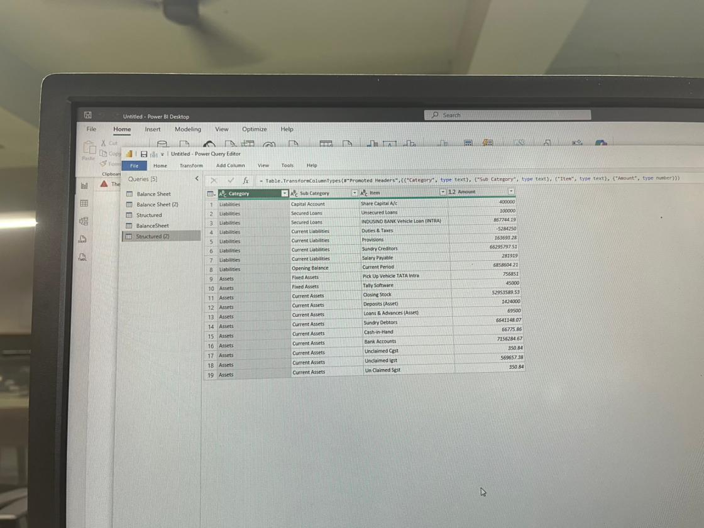
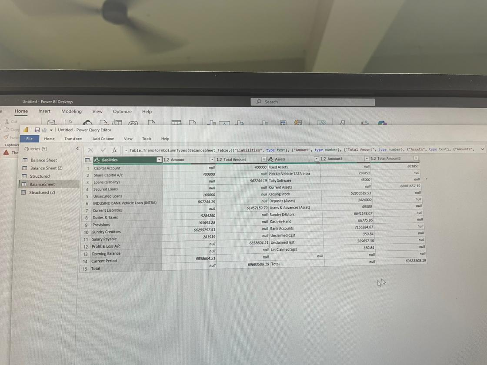

# Financial Data Structuring Using Power BI

## Project Overview
This project focuses on structuring and transforming balance sheet data using Microsoft Power BI.

## Tools Used
- Microsoft Excel
- Microsoft Power BI
- Power Query Editor

## Project Activities
- Importing financial data
- Structuring balance sheet information
- Organising assets and liabilities
- Data type transformation
- Data cleaning and preparation

## Learning Outcomes
- Understanding Power Query
- Learning data transformation techniques
- Working with financial datasets
- Improving practical Power BI skills
- ## Project Screenshots

### Power Query - Structured Financial Data

### Balance Sheet Data Transformation

## Author
Muhsina K.P
